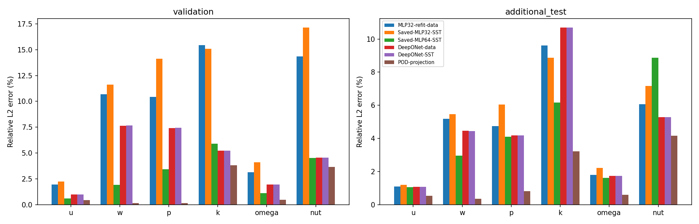
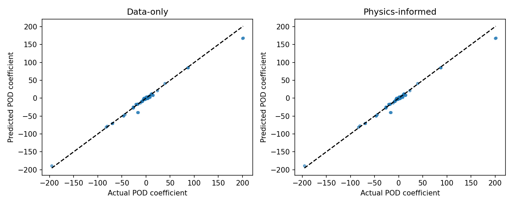

# DeepONet: measured results for the supplied NACA0012 project

These results were computed from the supplied analysis archive. Lower error is better. Percentages are relative L2 errors, not classification accuracy. Read DEEPONET_README.md for architecture, equations, commands and limitations.

## Training-only five-fold cross-validation

Both models use fixed settings. POD and scalers are rebuilt on each fold's 32 training cases. These are aggregate out-of-fold errors across 40 cases; they are not means of percentages. Physics fine-tuning is not included in this CV.

| Field | MLP 32–32 tanh | DeepONet data | Relative error reduction |
|---|---:|---:|---:|
| u | 1.498% | 1.068% | 28.7% |
| w | 5.663% | 3.537% | 37.5% |
| p | 6.102% | 3.720% | 39.0% |
| k | 15.781% | 11.462% | 27.4% |
| omega | 2.929% | 1.892% | 35.4% |
| nut | 5.728% | 3.424% | 40.2% |

Fold-to-fold standard deviation of global relative L2 errors (percentage points; five folds):

| Model | u | w | p | k | omega | nut |
|---|---:|---:|---:|---:|---:|---:|
| mlp | 0.702 | 3.839 | 2.922 | 7.824 | 1.073 | 2.546 |
| deeponet | 0.606 | 2.454 | 2.490 | 7.011 | 0.913 | 1.629 |

## Seven existing validation cases

| Model | u | w | p | k | omega | nut |
|---|---:|---:|---:|---:|---:|---:|
| MLP32-refit-data | 1.971% | 10.702% | 10.426% | 15.439% | 3.135% | 14.344% |
| Saved-MLP32-SST | 2.248% | 11.620% | 14.107% | 15.082% | 4.093% | 17.150% |
| Saved-MLP64-SST | 0.620% | 1.917% | 3.443% | 5.900% | 1.134% | 4.531% |
| DeepONet-data | 0.989% | 7.650% | 7.428% | 5.236% | 1.951% | 4.545% |
| DeepONet-SST | 0.991% | 7.679% | 7.457% | 5.244% | 1.957% | 4.548% |
| POD-projection | 0.460% | 0.151% | 0.155% | 3.827% | 0.486% | 3.655% |

Coefficient and physics metrics:

| Model | Coefficient standardized RMSE | Coefficient relative L2 | Coefficient R2 | Normalized physics score |
|---|---:|---:|---:|---:|
| MLP32-refit-data | 0.99836 | 38.090% | -0.54276 | 6.4856e+10 |
| Saved-MLP32-SST | 1.06879 | 44.594% | -0.90984 | 1.6041e+11 |
| Saved-MLP64-SST | 0.64109 | 8.611% | 0.25660 | 5.1967 |
| DeepONet-data | 0.65589 | 14.440% | 0.27164 | 9.3484e+05 |
| DeepONet-SST | 0.65585 | 14.489% | 0.27185 | 9.3175e+05 |
| POD-projection | 0.00000 | 0.000% | 1.00000 | 1.0142 |
| CFD | 0.00000 | 0.000% | 1.00000 | 0.36937 |

## Seven additional archived CFD cases

| Model | u | w | p | k | omega | nut |
|---|---:|---:|---:|---:|---:|---:|
| MLP32-refit-data | 1.108% | 5.192% | 4.753% | 9.608% | 1.796% | 6.069% |
| Saved-MLP32-SST | 1.198% | 5.463% | 6.053% | 8.876% | 2.218% | 7.176% |
| Saved-MLP64-SST | 1.063% | 2.961% | 4.098% | 6.157% | 1.611% | 8.868% |
| DeepONet-data | 1.088% | 4.458% | 4.194% | 10.699% | 1.734% | 5.287% |
| DeepONet-SST | 1.088% | 4.452% | 4.191% | 10.699% | 1.732% | 5.288% |
| POD-projection | 0.535% | 0.354% | 0.819% | 3.227% | 0.603% | 4.156% |

Coefficient and physics metrics:

| Model | Coefficient standardized RMSE | Coefficient relative L2 | Coefficient R2 | Normalized physics score |
|---|---:|---:|---:|---:|
| MLP32-refit-data | 1.28169 | 12.527% | 0.04022 | 3.0689e+09 |
| Saved-MLP32-SST | 1.29967 | 13.996% | 0.02711 | 1.5156e+10 |
| Saved-MLP64-SST | 0.98148 | 13.506% | 0.46286 | 2.4472e+10 |
| DeepONet-data | 0.96818 | 11.944% | 0.57703 | 2.426e+08 |
| DeepONet-SST | 0.96807 | 11.942% | 0.57715 | 2.4726e+08 |
| POD-projection | 0.00000 | 0.000% | 1.00000 | 1.2085 |
| CFD | 0.00000 | 0.000% | 1.00000 | 0.67265 |

## Comparison with the original three-field POD-MLP

All methods below use the original dimensional Cartesian validation targets and grid. The original model has four modes and three fields; DeepONet uses 16 modes and six fields, so this comparison includes representation differences.

| Model | u | w | p |
|---|---:|---:|---:|
| Original-POD-MLP | 0.843% | 1.622% | 3.725% |
| DeepONet-data | 0.349% | 6.280% | 4.438% |
| DeepONet-SST | 0.350% | 6.306% | 4.457% |
| POD-projection | 0.258% | 0.148% | 0.041% |

## Wall pressure and runtime

| Model | Validation Cp RMSE |
|---|---:|
| MLP32-refit-data | 0.080443 |
| Saved-MLP32-SST | 0.117644 |
| Saved-MLP64-SST | 0.036194 |
| DeepONet-data | 0.053758 |
| DeepONet-SST | 0.053966 |
| POD-projection | 0.017597 |

DeepONet-data: median resident CPU coefficient prediction plus six-field reconstruction 5.801 ms; p95 6.349 ms. File loading and CFD runtime are not included.

DeepONet-SST: median resident CPU coefficient prediction plus six-field reconstruction 6.012 ms; p95 6.385 ms. File loading and CFD runtime are not included.

## Did physics fine-tuning help?

The mean training physics loss changed from 0.857178 after the first update to 0.855233 after the last update. Data loss changed from 0.00004128 to 0.00004089; wall loss from 0.00188051 to 0.00188018.

The difference between DeepONet-data and DeepONet-SST includes field and wall supervision as well as PDE residuals; it is not a pure residual-only ablation. Judge both CFD error and residual consistency. A lower training residual does not establish better held-out accuracy.

On validation, SST fine-tuning reduces field error for none of the six fields. Its normalized physics score is 931754.40351, versus 934840.16978 for data-only.
On additional_test, SST fine-tuning reduces field error for u, w, p, k, omega. Its normalized physics score is 247259728.02358, versus 242600866.54908 for data-only.

## Physics generalization failure

The very large held-out physics scores are real diagnostics from the inherited residual code, not percentages. The omega transport term dominates. DeepONet-SST predicts negative omega at about 0.107% of validation points and 0.720% of additional-test points. The residual code clamps omega to 1e-8 internally; the cross-diffusion term divides by omega, making it extremely sensitive in these regions. Clamping inside the residual does not enforce positive predicted fields.

This model is therefore not established as a physically reliable replacement. A next study should evaluate a positivity-preserving turbulence representation, additional training-only collocation conditions, and an independently held-out test set. Those changes would alter the representation/training protocol and were not tuned on these evaluation cases.

The saved 64–64 SST MLP remains better on five of the six native validation fields; DeepONet improves k. Against the original three-field POD-MLP on its own grid, DeepONet improves u but worsens w and p. Consequently there is no across-the-board DeepONet winner.

## Interpretation and limits

DeepONet outperforms the paired data-only tanh MLP on every global field in the five-fold experiment. This supports this fixed training configuration. It does not prove that DeepONet is universally superior: capacities and optimizer budgets differ, the dataset is small, and only one seed and one architecture were evaluated.

40 training only; fixed settings before evaluation. Validation and additional cases were previously inspected in the project, so neither is a newly untouched test set.

The additional CFD runs meet the archived residual-control criterion but fail its stricter last-50 force-stability check. Their results should be treated as diagnostic comparisons. No new CFD cases or untouched test set were generated.

The original raw 40+7 CFD archive could not be accessed. Saved native snapshots, saved MLP checkpoints, saved original-grid targets, and additional CFD exports were sufficient for this analysis. Total CL/CD are not evaluated: the old project's CL/CD MLP is a separate task and is not the reconstructed field model.

The residual equations were verified against the original source on a synthetic state. Four unit tests passed, checkpoint inference was compared with saved validation predictions, and all original archive files were verified unchanged. See outputs/deeponet_sst/verification.json.

Detailed coefficient errors, per-case and regional field errors, positivity fractions, wall errors and six residual RMS values are in outputs/deeponet_sst/evaluation. The pressure parity plots and Cp curves are diagnostic; coefficient errors depend on the chosen scaled POD basis.

