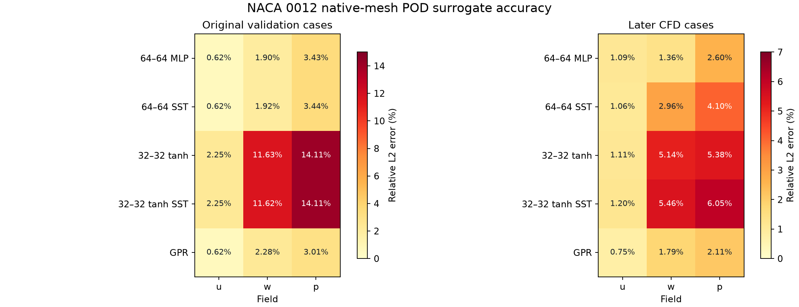

# NACA 0012 surrogate model comparison

The project contains six model families, with the selected 32–32 tanh trial
having both data-only and SST-trained checkpoints. Each branch below has its
source, model artifacts, predictions, and results. Git LFS is required to
download the `.npz`, `.pt`, and `.joblib` files.

| Branch | Representation and predictor | Training distinction |
| --- | --- | --- |
| [Original POD–MLP](https://github.com/D-luffy56/naca0012_surrogate_model/tree/variant/original-pod-mlp) | Common 192×128 grid; `u,w,p`; 4 modes; 64–64 ReLU MLP | Data only |
| [Earlier RANS POD–MLP](https://github.com/D-luffy56/naca0012_surrogate_model/tree/variant/earlier-rans-pod-mlp) | Same three-field grid and MLP | Approximate mean-flow RANS regularization |
| [Native POD–MLP](https://github.com/D-luffy56/naca0012_surrogate_model/tree/variant/native-pod-mlp) | Native mesh; `u,w,p,k,omega,nut`; 16 modes; 64–64 ReLU MLP | Data only; estimator newly refitted and saved |
| [Native SST POD–MLP](https://github.com/D-luffy56/naca0012_surrogate_model/tree/variant/native-sst-pod-mlp) | Same native POD; saved 64–64 ReLU checkpoint | Approximate SST and wall losses |
| [Selected settings](https://github.com/D-luffy56/naca0012_surrogate_model/tree/variant/selected-settings-tanh) | Same native POD; 32–32 tanh, L-BFGS, L2=0.0001 | Data-only refit and saved SST checkpoint |
| [Native POD–GPR](https://github.com/D-luffy56/naca0012_surrogate_model/tree/variant/native-pod-gpr) | Same native POD; Matérn 5/2 Gaussian process | Data only; fitted estimator now saved |

The original seven validation cases and the seven later CFD cases are distinct
evaluation sets. All errors below are pooled relative L2 over the named field,
in percent; lower is better. The common grid and native mesh sample different
points and fields, so compare the first two rows with each other and the native
rows with each other.

## Original seven validation cases

| Model | u | w | p |
| --- | ---: | ---: | ---: |
| Original common-grid POD–MLP | 0.843 | 1.622 | 3.725 |
| Earlier common-grid RANS POD–MLP | 0.862 | 1.592 | 3.737 |
| Native 64–64 data-only POD–MLP | **0.618** | **1.902** | 3.426 |
| Native 64–64 SST POD–MLP | 0.620 | 1.917 | 3.443 |
| Native 32–32 tanh data-only | 2.249 | 11.632 | 14.108 |
| Native 32–32 tanh SST | 2.248 | 11.620 | 14.107 |
| Native POD–GPR | 0.622 | 2.285 | **3.013** |

Bold in the native rows marks the lowest native-mesh error for each field.
The common-grid rows have their own representation and should not be ranked
against those bold values.

## Seven later CFD cases

| Native-mesh model | u | w | p |
| --- | ---: | ---: | ---: |
| 64–64 data-only POD–MLP, historical refit | 1.094 | **1.355** | 2.602 |
| 64–64 SST POD–MLP, saved checkpoint | 1.063 | 2.961 | 4.098 |
| 32–32 tanh data-only, historical refit | 1.113 | 5.144 | 5.381 |
| 32–32 tanh SST, saved checkpoint | 1.198 | 5.463 | 6.053 |
| POD–GPR | **0.751** | 1.786 | **2.115** |

These figures are the historical comparison. The older data-only sklearn
estimators were not saved. We refitted and saved them on the variant branches;
their measured errors differ from the historical run:

| Newly saved refit on later CFD | u | w | p |
| --- | ---: | ---: | ---: |
| 64–64 data-only POD–MLP | 1.139 | 3.213 | 4.406 |
| 32–32 tanh data-only | 1.044 | 4.569 | 4.765 |
| POD–GPR | 0.751 | 1.786 | 2.115 |

Use the corresponding branch's `outputs/.../summary.json` when reporting
performance of a downloaded estimator. The newly saved GPR matches the old
GPR results closely; the MLP refits do not reproduce the older comparison
exactly. The saved SST checkpoints retain their original results.

## What the comparison supports

- On the later CFD cases, the historical GPR has the lowest u and p errors;
  the historical 64–64 data-only MLP has the lowest w error. SST training did
  not lower all three field errors in these comparisons.
- Five-fold cross-validation inside the 40 development cases favored MLP over
  GPR for u/w/p: MLP 1.142% / 5.311% / 6.517% versus GPR
  1.455% / 8.994% / 9.505%. This is a different test from the later CFD cases.
- The seven later CFD runs met solver residual control but all failed the
  stricter force-history stability criterion. They have already been inspected
  and should not be described as untouched for future selection.
- CL and CD are predicted by a separate companion MLP. They are not integrated
  from any of the six POD field models, so the CL/CD errors do not rank these
  field-model variants. Consistent per-model runtime measurements are also
  unavailable; the original baseline's timing is not a cross-model benchmark.
- SST losses use approximate graph derivatives and CFD wall targets. They do
  not exactly reproduce OpenFOAM's finite-volume SST operators.

Detailed values for all six predicted fields, source provenance, and the
newly saved refits are in
[`all_field_errors.csv`](results/model_comparison/all_field_errors.csv).
The original trial log is in
[`historical_model_variations.csv`](results/model_comparison/historical_model_variations.csv),
and the development cross-validation summary is in
[`development_cv_summary.json`](results/model_comparison/development_cv_summary.json).
The additional physics-weight sweep appears in the historical trial log; it
is an SST subtrial rather than one of the six named model families.
